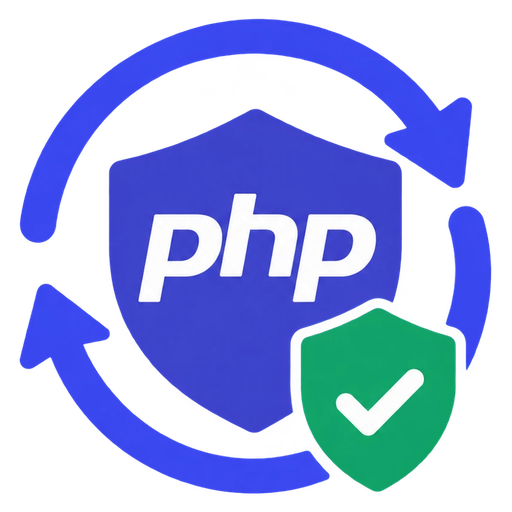

<p align="center">
  
</p>

<h1 align="center">php2shell-migration</h1>

<p align="center">
  <strong>A skill for AI coding agents that finds out whether your PHP application is exposed to PHP2Shell, fixes it safely, and tells you honestly what was and wasn't verified.</strong>
</p>

PHP2Shell is the name for two critical PHP vulnerabilities, CVE-2026-109618 and CVE-2026-109619. They allow unauthenticated remote code execution on PHP servers that handle web requests. PHP fixed them on 2026-10-21 in **8.5.12, 8.4.27, 8.3.36 and 8.2.35**. PHP 8.1 and older get no official fix. ([php.net announcement](https://www.php.net/archive/2026.php#2026-10-21-5))

Install this skill and ask your agent (Claude Code, Codex, Copilot, Cursor, Gemini CLI, OpenCode, ...) something like *"check this project for PHP2Shell"*. The agent then:

1. Works out which PHP version **actually serves your website**, not just the one on your laptop.
2. Tells you whether that version is affected, out of support, or fine.
3. Plans the fix: first the PHP patch, then any framework upgrade (Laravel, WordPress, Symfony, Drupal and 19 more).
4. Makes the changes on a separate git branch and runs your project's tests.
5. Writes a report that separates "fixed and checked" from "not checked yet".

It never deploys to production, never runs exploits, and never reports a test as passed unless it actually ran.

---

## Quick start

**1. Install** (needs Python 3.8 or newer). From this folder:

```bash
python scripts/install.py
```

This makes the skill available to all supported agents on your computer. Use `python3` on macOS/Linux if `python` isn't found.

**2. Open your agent in your PHP project.**

**3. Ask:**

> Use php2shell-migration to check this project for PHP2Shell and make a plan. Don't change anything yet.

That's it. Read on for what to ask next and how to read the results.

---

## Install

### For all agents on your computer (recommended)

```bash
python scripts/install.py
```

The skill goes into two folders that, between them, every supported agent reads:

- `~/.agents/skills/php2shell-migration`: read by Codex, Copilot, Cursor, Gemini CLI and OpenCode
- `~/.claude/skills/php2shell-migration`: read by Claude Code (a link to the first folder)

Run the same command again later to update. To remove it: `python scripts/install.py --uninstall`.

### For one project, shared with your team

```bash
python scripts/install.py --scope project --project /path/to/your/repo
```

Then commit the new `.agents/skills/` and `.claude/skills/` folders. Everyone who opens the repository with a supported agent gets the skill.

### For specific agents only

```bash
python scripts/install.py --tool codex                  # just Codex
python scripts/install.py --tool claude-code --tool cursor
python scripts/install.py --list                        # every tool and folder
```

### claude.ai (web and desktop app) or the Claude API

```bash
python scripts/install.py --zip dist/php2shell-migration.zip
```

Upload the zip in claude.ai and enable it under **Customize > Skills** (needs a paid plan with code execution turned on), or upload it through the Claude Skills API. In these sandboxes the agent can't reach your servers or the internet, so it gives you an analysis and a plan rather than a verified fix.

### Supported tools

| Agent | Where it looks (project / personal) | How to call the skill explicitly |
|---|---|---|
| Claude Code | `.claude/skills` / `~/.claude/skills` | `/php2shell-migration` |
| OpenAI Codex (CLI, IDE, app) | `.agents/skills` / `~/.agents/skills` | `$php2shell-migration` or `/skills` |
| GitHub Copilot (VS Code, CLI, cloud agent) | `.github/skills`, `.claude/skills`, `.agents/skills` / `~/.copilot/skills`, `~/.agents/skills` | `/php2shell-migration` |
| Cursor | `.cursor/skills`, `.agents/skills`, `.claude/skills`, `.codex/skills` / same under `~/` | `/php2shell-migration` |
| Gemini CLI | `.gemini/skills`, `.agents/skills` / `~/.gemini/skills`, `~/.agents/skills` | asks before activating; `/skills list` |
| OpenCode | `.opencode/skills`, `.claude/skills`, `.agents/skills` / `~/.config/opencode/skills`, `~/.claude/skills`, `~/.agents/skills` | used automatically |
| claude.ai, Claude API | zip upload (see above) | used automatically |
| Other Agent Skills tools | usually `.agents/skills` / `~/.agents/skills`; or `--dir <folder>` | per tool |

These folders come from each vendor's documentation, read on 2026-10-24: [Claude Code](https://code.claude.com/docs/en/skills), [Codex](https://learn.chatgpt.com/docs/build-skills), [VS Code Copilot](https://code.visualstudio.com/docs/agent-customization/agent-skills), [Copilot CLI](https://docs.github.com/en/copilot/how-tos/copilot-cli/customize-copilot/add-skills), [Cursor](https://cursor.com/docs/skills), [Gemini CLI](https://geminicli.com/docs/cli/skills/), [OpenCode](https://opencode.ai/docs/skills/), [claude.ai](https://support.claude.com/en/articles/12512198-creating-custom-skills), [Claude API](https://platform.claude.com/docs/en/agents-and-tools/agent-skills/overview), [shared `.agents/skills` convention](https://agentskills.io/client-implementation/adding-skills-support). Claude Code was confirmed to load the skill after `install.py`; the others were not tested end to end.

Most agents use the skill automatically when your request matches it. You only need the explicit call if it doesn't kick in.

---

## How to use it

### What to ask

Start with a check, then move step by step. Each request below builds on the previous one.

| You want to... | Ask your agent |
|---|---|
| Know if you're affected | *"Use php2shell-migration to check this project for PHP2Shell. Report only, don't change files."* |
| Get a plan | *"Make a migration plan with php2shell-migration: target PHP version, framework upgrades, risks and rollback."* |
| Patch PHP only (fastest fix) | *"Update the PHP version in our Dockerfile and CI to the patched release for our branch, then run the tests and write the report."* |
| Upgrade the framework too | *"Upgrade this Laravel 10 app to a supported Laravel and PHP version without changing behaviour. One stage at a time, tests after each."* |
| Rescue an old app | *"This app runs on PHP 5.6. Make an incremental plan to reach a supported PHP version, and list the blockers."* |
| Check a server you manage | *"Here's the output of `php-fpm -v` from our staging server: ... Is it patched?"* |

Tips:

- **Start in "report only" mode.** You stay in control: the agent explains before it edits.
- **Give it access to a staging or test environment if you can.** Without one it can't confirm which PHP version really serves your site, and the report will say so.
- **Commit or stash your own work first.** The skill works on a new branch and won't discard your changes, but a clean tree makes the diff easy to review.

### What the agent does

1. **Looks around (no edits).** It finds every PHP app in the repository, its framework and version, and every place a PHP version is declared: Dockerfile, docker-compose, CI, web server config, `.php-version`. It keeps three of them apart:
   - **web**: what serves your site (this is what matters for PHP2Shell)
   - **cli**: what's on your machine
   - **ci**: what your tests run on
2. **Classifies the problem** into one or more of these:
   - *runtime affected*: patch PHP now, same version branch.
   - *runtime unsupported*: PHP branch is end-of-life, so a migration is needed.
   - *framework outdated*: PHP is fine, but the framework or CMS needs an upgrade.
   - *vulnerable dependency*: a package or plugin has a known advisory.
   - *deployment mismatch*: your code says one PHP version, your servers use another.
   - *unknown*: not enough evidence. It tells you what's missing.
3. **Writes a plan** (`migration-plan.md`) before touching anything. The plan covers target versions with sources, upgrade stages, risks and rollback.
4. **Makes the changes on a new git branch**, one stage per commit. The PHP patch always comes first, because it's the urgent part and usually needs no code changes.
5. **Tests your application.** It runs syntax checks, `composer audit`, static analysis, your test suite, and smoke tests and database migrations in a test environment. Anything it couldn't run is marked *blocked* with the reason.
6. **Reports** in `test-results.json`, `test-results.md` and `migration-report.md`.

### Reading the result

Every report answers five questions separately, because each one can be true while the others are false:

| Question | Example answer |
|---|---|
| Is the PHP runtime patched (checked by running it)? | yes: PHP 8.4.27 observed |
| Is the application migration done? | yes (completed) |
| Did the automated tests pass? | yes: 420 tests |
| Was the PHP that **serves the website** checked? | **no**: no access to staging |
| Are there remaining security findings? | 1 (a package advisory) |

The overall result is one of:

| Result | What it means for you |
|---|---|
| `verified` | Everything in scope ran and passed, including the web server's PHP, and no findings remain. This still doesn't mean "the app is secure", only that the checked things are fine. |
| `partially_verified` | Good progress, but something wasn't checked or a finding is open. Read the limitations list. |
| `failed` | At least one check failed. Read which one. |
| `blocked` | Nothing could be checked yet (missing PHP, database, access...). The report says what's needed. |
| `not_verified` | Nothing has been run yet (for example, plan only). |

The result is calculated from the recorded evidence, so the agent can't round it up. If it says `partially_verified`, believe it.

---

## Quick checks without an agent

The bundled scripts work on their own. They need only Python and make no network calls.

**Is this PHP version affected?**

```bash
python scripts/check-php-version.py "$(php -v | head -n1)"
```

```text
PHP 8.3.30 (cli): runtime_affected [branch supported]
  CVE-2026-109618: affected (fixed in 8.3.36)
  CVE-2026-109619: affected (fixed in 8.3.36)
  note: CLI runtime only: this does not verify the PHP version serving web requests (FPM/mod_php/CGI).
```

Exit code: `0` patched, `2` affected or end-of-life, `3` can't tell (for example a Linux distribution build that may contain a backported fix: check your vendor's security notice).

**What's in this project?**

```bash
python scripts/detect-project.py /path/to/project
```

```text
# (trimmed output for a WordPress site)
[.]
  WordPress 6.9.1 - confidence high; lifecycle supported (cycle 6.9, latest 6.9.10, PHP see docs)
  runtime[web] PHP 8.1 from deploy/nginx.conf: runtime_unsupported

Findings:
  [high] runtime_unsupported: web runtime PHP 8.1 declared in deploy/nginx.conf is runtime unsupported
```

It never runs your code and hides passwords and keys in its output. Add `--json --output detect.json` for machine-readable output.

**Is a results report honest and complete?**

```bash
python scripts/validate-results.py test-results.json --markdown test-results.md
```

---

## Supported frameworks and apps

Laravel · Symfony · WordPress · Drupal · CodeIgniter · Yii · CakePHP · Joomla · October CMS · SuiteCRM · EspoCRM · Nextcloud · Magento / Adobe Commerce · PrestaShop · OpenCart · Slim · Dolibarr · TYPO3 · Moodle · MediaWiki · Laminas · Phalcon · phpMyAdmin, plus a general procedure for custom or unlisted PHP projects.

Each has its own guide in [references/frameworks/](references/frameworks/) covering how to identify the version, PHP compatibility, the upgrade path, tooling, tests and rollback. Worked examples: [Laravel](examples/laravel-migration.md), [WordPress](examples/wordpress-migration.md), [legacy PHP 5.6 app](examples/legacy-php-migration.md).

---

## What it will never do

- Deploy anything or change production servers or production databases.
- Run exploit code or expose a vulnerable server to "test" it.
- Print your secrets (`.env`, `wp-config.php` and similar) or put `phpinfo()` on a public page.
- Force dependency installs (`--ignore-platform-reqs`), switch off security checks, or delete features to make an upgrade pass.
- Throw away your uncommitted changes.
- Invent versions, CVEs or test results. When it doesn't know, it says "unknown".

If you need to buy time before you can update, php.net lists temporary mitigations, and the skill can apply them. They are **not** a fix; php.net's own words are "updating is the only safe choice". See [php2shell-advisories.md](references/security/php2shell-advisories.md#interim-mitigations-not-fixes).

---

## Troubleshooting

**The agent doesn't use the skill.** Call it explicitly (see "Supported tools"), or restart the agent. Some tools only load project-level skills in folders you've marked as trusted. Check it's installed with `python scripts/install.py --list` and look in the listed folders.

**I edited the skill but the agent still uses the old version.** The installer copies the files. Re-run `python scripts/install.py`, or install once with `--mode symlink` so the agents read this folder directly.

**My agent shows the skill twice.** Cursor, Copilot and OpenCode read both `.agents/skills` and `.claude/skills`. The two entries are identical. Install only for your tools with `--tool` if it bothers you.

**`python` not found / Windows.** Use `py -3 scripts\install.py` on Windows, or `python3` on macOS/Linux.

**My agent doesn't support skills.** Install to any folder (`--dir ~/skills`) and add this to your project's `AGENTS.md` or rules file:

```markdown
## PHP2Shell / PHP upgrades
For PHP2Shell remediation or PHP/framework upgrades, read and follow
~/skills/php2shell-migration/SKILL.md. Resolve its relative paths against that directory.
```

**There's no PHP or Composer on my machine.** The agent can still analyse and plan, and can use your project's Docker container if there is one. Steps that need PHP are reported as *blocked*, not skipped silently.

**The report says `partially_verified` but all tests passed.** Probably the website's PHP version wasn't observed directly (no staging access), or a finding is still open. The limitations section says which.

---

## Limits to know about

- The skill reads version declarations from your files. Only a check on the server proves what's really running, and the report says which one you got.
- Version and support data was checked on 2026-10-24. The agent is told to re-check the official sources before acting, and it records when it couldn't.
- For 11 of the 23 projects there is no public lifecycle data, so "is this version still supported?" comes back as *unknown*: CodeIgniter, Yii, October CMS, SuiteCRM, EspoCRM, PrestaShop, OpenCart, Slim, Dolibarr, Laminas and Phalcon.

---

Built on the open [Agent Skills format](https://agentskills.io/specification), so it isn't tied to one vendor. Maintaining or extending the skill? See [CONTRIBUTING.md](CONTRIBUTING.md). License: [MIT](LICENSE).
